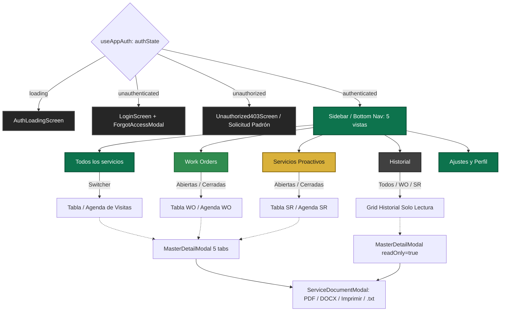
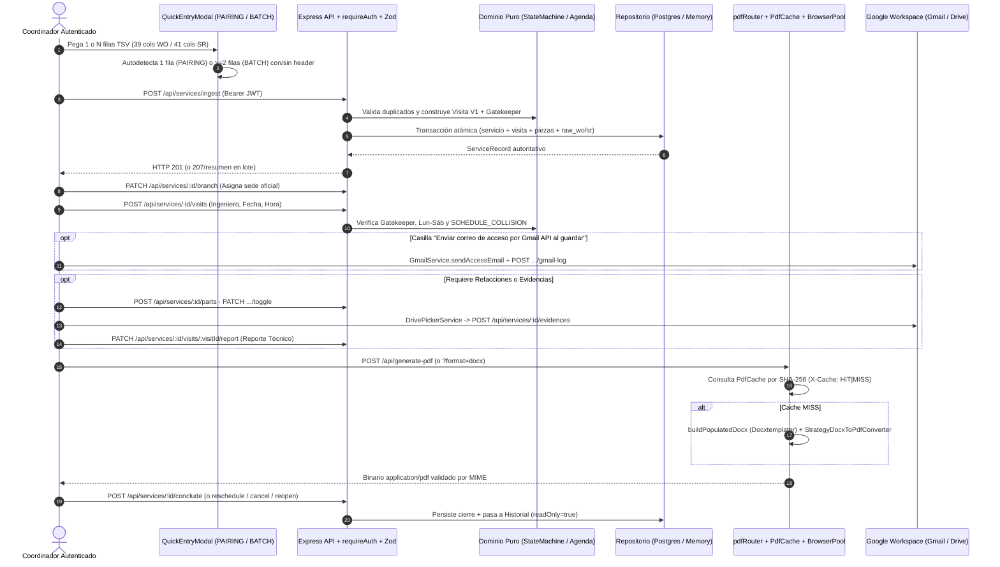
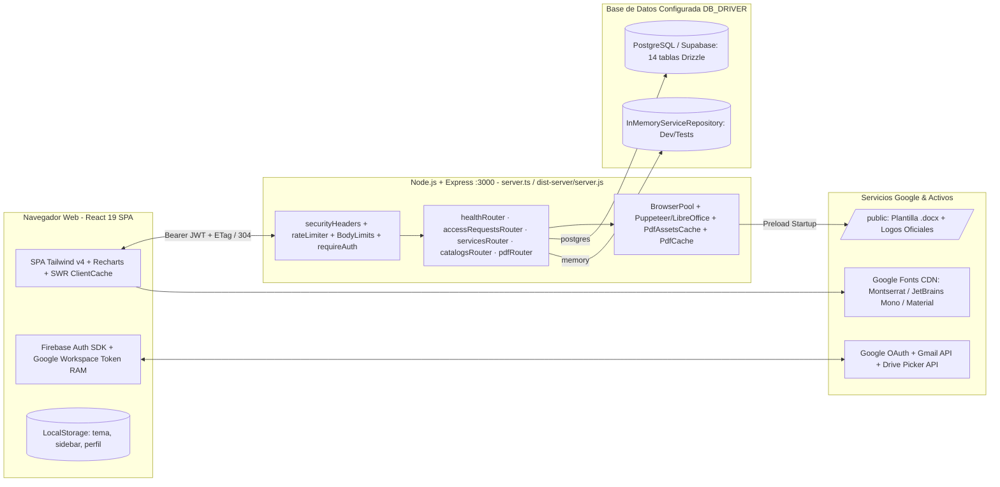

# Especificación de Arquitectura de Software — Lexmark’s Control
**Estándar de Referencia**: IEEE Std 1016-2009 / ISO/IEC/IEEE 42010:2011  
**Organización**: Alpha Digital / Baja Digital  
**Versión de Arquitectura**: 3.1.0 (Full-Stack React 19 + Express + PostgreSQL/Drizzle + Puppeteer/Docxtemplater + Hardening & Prod Build)

---

## 1. Identificación y Alcance del Sistema

**Lexmark’s Control** es una plataforma web *full-stack* (SPA en React 19 servida sobre Node.js + Express en el puerto `3000`) orientada a la coordinación de servicios de campo, programación en agenda técnica, despacho de ingenieros, control logístico de refacciones y emisión documental oficial para impresoras y multifuncionales corporativos Lexmark (Soriana, Walmart, Monte de Piedad, entre otros).

### Objetivos Arquitectónicos
1. **Seguridad Autenticada de Extremo a Extremo**: Acceso exclusivo mediante Google OAuth (Firebase Auth) restringido a una lista blanca corporativa de 5 cuentas autorizadas, con verificación de `Bearer <idToken>` vía `firebase-admin` en todas las rutas protegidas de `/api/*`.
2. **Núcleo de Dominio Puro e Inmutable (`src/domain/`)**: Reglas de negocio (máquina de estados, compuerta *Gatekeeper*, semáforo SLA, agenda semanal/mensual, reglas de horario y 16 marcadores) compartidas sin duplicación ni dependencias de DOM entre el servidor Express y el cliente React.
3. **Persistencia Relacional Agnóstica al Motor**: Capa de repositorios por interfaces (`IRepositoryContainer`) intercambiable por variable de entorno (`DB_DRIVER=postgres|memory`), soportando PostgreSQL / Supabase (14 tablas relacionales incluyendo `access_requests` + respaldo JSONB en `raw_wo`/`raw_sr` mediante Drizzle ORM) y adaptador en memoria para pruebas rápidas.
4. **Motor Documental Determinista con Caché Multi-Capa**: Generación Word (`.docx` con `Docxtemplater` vía `buildPopulatedDocx.ts`) y compilación PDF idéntica a partir de ese `.docx` (`StrategyDocxToPdfConverter`: LibreOffice headless o fallback Puppeteer OOXML `docx-preview`/`jszip`) respaldada por `BrowserPool`, `PdfAssetsCache`, `PdfCache` (LRU + SHA-256 + TTL), caché cliente SWR (`clientCache.ts`) y cabeceras HTTP `ETag`/`304`.
5. **Ergonomía Multi-Dispositivo y Code Splitting**: Tabla paginada (`25`/`50`/`100`) y ordenable (`ID Servicio`, `Cliente`, `Límite`) de **9 columnas** y vista Agenda (`Semana` / `Mes`) en escritorio, transformadas de forma fluida a tarjetas táctiles, agenda diaria deslizable y barra de navegación inferior (`bottom-0`) en teléfonos móviles ($< 768\text{px}$), con carga diferida (`React.lazy` + `Suspense`) para gráficas, agenda, ajustes y modales pesados.

---

## 2. Vista Arquitectónica de Capas (Diagrama C4 Nivel 2)

```
┌────────────────────────────────────────────────────────────────────────────┐
│                        CAPA DE PRESENTACIÓN (UI - React 19)                │
├────────────────────────────────────────────────────────────────────────────┤
│ • pages/              : ServicesWorkspacePage.tsx y SettingsPage.tsx con   │
│                         React.lazy + Suspense (DashboardMetrics, Agenda,   │
│                         SettingsView) y skeletons/* de respaldo            │
│ • auth/               : AuthStatusScreens, LoginScreen, ForgotAccessModal, │
│                         Unauthorized403Screen                              │
│ • common/             : BrandLogo (BrandLogo.svg), AccessibleModal,        │
│                         ConfirmActionModal, GlobalQuickSearchModal (Ctrl+K)│
│ • Header.tsx          : BrandLogo SVG oficial, SLA real, búsqueda y perfil │
│ • layout/             : Sidebar, DesktopSidebar, MobileBottomNav,          │
│                         MobileBranchSheet                                  │
│ • DashboardMetrics    : Gráficas Recharts (dashboard/MetricKpiCards,       │
│                         MetricArcGauge, MetricBranchChart)                 │
│ • VisitCalendarView   : Agenda Semana/Mes [Tabla|Agenda] (calendar/*)      │
│ • ServiceTable.tsx    : Grid 9 cols paginado/ordenable (services/* +       │
│                         ServiceModalsHost.tsx lazy para modales pesados)   │
│ • QuickEntryModal.tsx : Pegado TSV 39/41 (PAIRING individual o BATCH)      │
│ • MasterDetailModal   : Expediente 5 tabs (modals/*, RawBackupViewer,      │
│                         DriveEvidencesSection, TechnicalReportSection)     │
│ • modals/             : AssignBranch, AssignVisit, Reschedule, Cancel/Reop,│
│                         Eta, Email, ConfirmPartArrival, NationalCatalog    │
│ • ServiceDocumentModal: Vista previa oficial (BrandLogo), PDF, DOCX y .txt │
│ • SettingsView.tsx    : Perfil, CRUD Ingenieros, Conexiones y Solicitudes  │
└─────────────────────────────────────┬──────────────────────────────────────┘
                                      │ Hooks, Puertos DIP (src/ports/) y Caché
┌─────────────────────────────────────▼──────────────────────────────────────┐
│              CAPA DE ESTADO CLIENTE, AUTH, WORKSPACE Y CACHÉ SWR           │
├────────────────────────────────────────────────────────────────────────────┤
│ • hooks/              : useAppAuth, useServiceManager (+ 4 hooks de acción │
│                         Ingest/Resource/Workflow/Catalog), usePullToRefresh│
│                         (async real), useServiceTableState, Calendar, etc. │
│ • serviceApiClient.ts : Cliente modular (apiTransport, serviceQueryClient, │
│                         serviceCommandClient, evidenceAndCatalogClient)    │
│ • clientCache.ts      : Caché en memoria TTL + SWR + invalidación + logout │
│ • workspace/ & pdf/   : gmailService (anti-header-injection), drivePicker, │
│                         PdfService (validación MIME estricta)              │
└──────────────┬──────────────────────────────────────────────┬──────────────┘
               │ Importación directa (sin DOM)                │ HTTP/JSON + Bearer JWT
               ▼                                              ▼
┌─────────────────────────────────┐  ┌───────────────────────────────────────┐
│   NÚCLEO DE DOMINIO PURO        │  │  BACKEND EXPRESS (:3000 - server.ts)  │
│   (src/domain/)                 │  ├───────────────────────────────────────┤
├─────────────────────────────────┤  │ • securityHeaders + rateLimiter +     │
│ • serviceStateMachine (stateM/*)│  │   configureApiBodyParsers (100kb..5mb)│
│ • serviceQuery.ts (sort/paging) │  │ • requireAuth (Firebase Admin RBAC)   │
│ • scheduleRules.ts (Lun-Sáb)    │  │ • schemas/* (Zod) + healthRouter      │
│ • slaEvaluator.ts (Semáforo)    │  │ • accessRequestsRouter, catalogsRouter│
│ • duplicateValidator.ts         │  │ • servicesRouter (routes/services/*)  │
│ • visitAgenda.ts (agenda/*)     │  │ • pdfRouter + httpCache (ETag / 304)  │
│ • templateMarkers + rawTemplate │  │ • pdf/* (BrowserPool, PdfAssetsCache, │
│                                 │  │   PdfCache, StrategyDocxToPdfConverter│
└─────────────────────────────────┘  └───────────────────┬───────────────────┘
                                                         │ DIP (interfaces.ts)
                                     ┌───────────────────▼───────────────────┐
                                     │  REPOSITORIOS AGNÓSTICOS & DRIZZLE DB │
                                     ├───────────────────────────────────────┤
                                     │ • repositoryFactory (postgres|memory) │
                                     │ • PostgresServiceRepository (14 tablas│
                                     │   en src/db/schema/* + pg.Pool)       │
                                     │ • InMemoryServiceRepository (memory/*)│
                                     │ • seed.ts + migrateStatuses.ts        │
                                     └───────────────────────────────────────┘
```

---

## 3. Principios de Diseño y Buenas Prácticas

### A. Fuente Única del Dominio y Flujo Autorizado por Servidor
La interfaz no aplica mutaciones locales volátiles como verdad final: `useServiceManager.ts` ejecuta prevalidaciones rápidas con `StateMachineService` (`src/domain/`) y envía cada operación a la API REST (`/api/*`), donde el servidor vuelve a validar la transición, aplica reglas de negocio (`SCHEDULE_COLLISION`, *Gatekeeper*, `READ_ONLY_SERVICE`), persiste en repositorio y devuelve el `ServiceRecord` autoritativo.

### B. Gobierno Visual y Paleta Cromática Institucional (Regla 60-30-10)
- **60% Lienzo Neutro**: Fondo `#F8F9FA` en modo claro y `#181818` / `#1E1E1E` en modo oscuro.
- **30% Superficies Estructurales**: Tarjetas y tablas con bordes sutiles de `1px` (`border-neutral-200` / `border-neutral-800`), contraste WCAG AA y soporte móvil libre de desplazamiento horizontal (`overflow-x-hidden`, `min-w-0`).
- **10% Acentos Semánticos Estrictos**:
  - **Work Orders (WO)**: Verde corporativo claro (`#308C50`, variantes de contraste `#1b6b37` / `#5ce28a`).
  - **Servicios Proactivos (SR)**: Amarillo oro corporativo (`#D9B13B`, variantes de contraste `#8a6808` / `#f7d66d`).
  - **Identidad Alpha Digital**: Verde institucional profundo (`#0D734D`).
  - **Alertas / Cancelaciones**: Ámbar cálido (`#D99036`) y Rojo (`#DC2626`).
  - *(Regla estricta: Queda prohibido el uso de azul para tickets WO o SR).*

### C. Tipografía y Microtipografía
- **Fuente de Interfaz**: **Montserrat** (pesos 300, 400, 500, 600, 700), tamaño mínimo de lectura **`11px`** (`text-[11px]`).
- **Cifras y Datos Técnicos**: **JetBrains Mono** con `tabular-nums` en IDs de orden, números de serie, fechas, bloques horarios, contadores y métricas.
- **Iconografía**: **Material Symbols Outlined** y **Lucide React**.

### D. Preservación y Uso Exclusivo de Logotipos Oficiales
- **Logotipo Vectorial Unificado (`public/BrandLogo.svg` + `src/components/common/BrandLogo.tsx`)**: Se emplea en el favicon (`index.html`), cabecera (`Header.tsx`), pantallas de acceso (`LoginScreen`, `AuthStatusScreens`, `ForgotAccessModal`, `Unauthorized403Screen`) y hoja imprimible (`ServiceOrderPrintableSheet.tsx`) respetando estrictamente la paleta corporativa:
  - **Modo Claro y Hoja Imprimible (`surface="light"`)**: Verde `#308C50`.
  - **Modo Oscuro (`surface="dark"`)**: Claro de paleta `#F2EFDF`.
  - **Sobre Fondo Verde (`surface="green"`)**: Blanco `#FFFFFF`.
- **Activos Raster Oficiales para PDF Backend (`PdfAssetsCache`)**: `public/assets/aistudio/` conserva únicamente los dos PNG oficiales (`LOGO_CLARO_SIN_FONDO_486b43d6.png` y `LOGO_FONDO_OSCURO_b37fcf75.png`) para compilación documental sin red externa.
- **Regla**: Queda estrictamente prohibido alterar la geometría oficial de los logotipos o sustituirlos por figuras genéricas inventadas.

### E. Disciplina de Código Limpio y Límites de Archivo
- Ningún archivo de código en `src/`, `server.ts`, `api/` o `scripts/` supera las **250 líneas**. La arquitectura modular desacopla rutas, repositorios, caché PDF, dominio y componentes React por debajo de ese umbral, validado automáticamente en `verify-deploy-readiness.ts` y pruebas.

---

## 4. Estrategia de Responsividad (Desktop vs. Mobile)

| Dimensión | Vista Desktop ($\ge 768\text{px}$) | Vista Mobile ($< 768\text{px}$) |
| :--- | :--- | :--- |
| **Autenticación** | Tarjeta centrada con logotipo oficial adaptativo al tema y ayuda de acceso. | Tarjeta responsiva con botones táctiles y modales adaptados a viewport. |
| **Navegación Principal** | Slidebar lateral vertical colapsable (`280px` / `72px`) con 5 accesos y filtro de 9 sedes. | Barra inferior fija (`bottom-0`) con 5 accesos (`Todos`, `WO`, `SR`, `Historial`, `Ajustes`) + botón superior `Sedes`. |
| **Espacio de Trabajo** | Conmutador `[Tabla | Agenda]`: Data Grid de 9 columnas (paginado 25/50/100 y ordenable) o Agenda Semana (Lun–Sáb) / Mes (Lun–Dom). | Lista vertical de tarjetas ordenables/paginadas con cuadrícula 3x1 (`Expediente`, `ETA`, `PDF`), Pull-to-Refresh async y Agenda diaria deslizable por tacto. |
| **Expediente Técnico** | Diálogo modal de 5 pestañas (`General`, `Equipo y Reporte`, `Piezas`, `Visitas`, `Datos Crudos`). | Hoja emergente inferior (`bottom sheet`) de hasta `94vh` con pestañas desplazables (`Crudos`, `Equipo`, etc.) y barra fija `Ver más` + acción primaria. |

---

## 5. Diagrama de Flujo de Vistas y Navegación (Formato Dual)

### A. Versión Gráfica Mermaid



### B. Versión Estructurada en ASCII

```
[ AuthGate (useAppAuth) ]
   ├── loading ──────────▶ AuthLoadingScreen
   ├── unauthenticated ──▶ LoginScreen (+ ForgotAccessModal)
   ├── unauthorized ─────▶ Unauthorized403Screen (Solicitud POST /api/access-requests)
   └── authenticated ────▶ SIDEBAR / BOTTOM NAV (5 Vistas)
                             │
    ┌────────────────┬───────┴─────────┬────────────────┬─────────────────┐
    ▼                ▼                 ▼                ▼                 ▼
[ Todos ]     [ Work Orders ]   [ Proactivas SR ]  [ Historial ]     [ Ajustes ]
 (Tabla |      (Abiertas/Cerr.)  (Abiertas/Cerr.)   (Todos/WO/SR)    (Perfil,
  Agenda)       + Tabla|Agenda    + Tabla|Agenda     Solo Lectura     Ingenieros,
    │                │                 │                │             Migración BD)
    └────────────────┴────────┬────────┴────────────────┘
                              ▼
             ┌──────────────────────────────────┐
             │ MasterDetailModal (5 Pestañas)   │
             │ General · Equipo/Reporte · Piezas│
             │ Visitas · Datos Crudos (39/41)   │
             └────────────────┬─────────────────┘
                              ▼
             ┌──────────────────────────────────┐
             │ ServiceDocumentModal             │
             │ Vista Previa · PDF · DOCX · .txt │
             └──────────────────────────────────┘
```

---

## 6. Diagrama de Flujo Operativo de Extremo a Extremo (Dual)

### A. Versión Gráfica Mermaid



### B. Versión Estructurada en ASCII

```
[ LOGIN GOOGLE ] ──▶ [ INGESTA TSV: PAIRING (1 fila) o BATCH (>=2 filas) ]
                                       │
                                       ▼
                        [ POST /api/services/ingest ]
                      (Bearer JWT + Zod + raw_wo/raw_sr)
                                       │
          ┌────────────────────────────┴────────────────────────────┐
          ▼                                                         ▼
 [ Nuevo: Asignar Sucursal ]                          [ Con pieza Necesaria ]
          │                                            (Pendiente por Pieza)
          ▼                                                         │
 [ Programar Visita (Lun-Sáb) ] ◀──── [ Confirmar 100% Piezas ] ◀──┘
 (Alerta traslape + Gmail API opcional) (Listo para Agendar)
          │
          ├──▶ [ Evidencias Google Drive + Reporte Técnico de Ejecución ]
          ├──▶ [ POST /api/generate-pdf (?format=docx) | PdfCache HIT/MISS ]
          ├──▶ [ Reagendar con Motivo ] ──▶ Visita N+1
          └──▶ [ Concluir / Cancelar ]  ──▶ Historial (Solo Lectura / Reapertura)
```

---

## 7. Diagrama de Red y Topología de Despliegue (Dual)

### A. Versión Gráfica Mermaid



### B. Versión Estructurada en ASCII

```
┌────────────────────────────────────────────────────────────────────────────┐
│                NAVEGADOR CLIENTE (React 19 + Tailwind v4 + SWR)            │
│ • Auth: Firebase Auth SDK (Google Popup) + Token Workspace en RAM          │
│ • Caché Lectura: ClientCache (TTL + SWR + If-None-Match / ETag)            │
│ • Preferencias UI Locales: lexmark_theme, lexmark_sidebar_collapsed        │
└────────────────────────────────────┬───────────────────────────────────────┘
                                     │ HTTPS/REST + Authorization: Bearer
┌────────────────────────────────────▼───────────────────────────────────────┐
│   SERVIDOR FULL-STACK (Express :3000 - server.ts / dist-server/server.js)  │
│ • Hardening: corsConfig + securityHeaders (CSP, nosniff, HSTS) + Zod +    │
│   rateLimiter (60/m IP anon, 300/m por uid, 20/m PDF, 30/m ingest, 10/m)  │
│ • Auth & Públicos: requireAuth (BD users + RBAC roles) · Públicos:        │
│   GET /api/health (200/503) y POST /api/access-requests (10 / 15m)         │
│ • Protegidos: /api/services*, /api/catalogs*, /api/raw-backup*,            │
│   /api/generate-pdf (límite JSON 100kb default / 1–5mb por ruta)           │
│ • Motor PDF & Ciclo Vida: PdfAssetsCache + PdfCache (LRU 50) + BrowserPool │
│   + createGracefulShutdown (SIGTERM/SIGINT cierra HTTP, Browser y pg.Pool) │
└────────────────────────────────────┬───────────────────────────────────────┘
                                     │ Drizzle ORM (pg.Pool) / InMemory
┌────────────────────────────────────▼───────────────────────────────────────┐
│              BASE DE DATOS & SERVICIOS EXTERNOS DE GOOGLE                  │
│ • PostgreSQL / Supabase: 14 tablas (servicios, visitas, piezas,            │
│   evidencias_drive, raw_wo, raw_sr, audit_logs, catálogos, users, access)  │
│ • Google APIs Cliente: Gmail API (pases acceso) + Drive Picker API         │
│ • Activos Oficiales: /assets/aistudio/LOGO_*.png y Plantilla (3).docx      │
└────────────────────────────────────────────────────────────────────────────┘
```

---

## 8. Catálogo de Preferencias Visuales y Nombres Literales en Pantalla

| Elemento UI | Texto Literal en Código | Propósito / Ubicación |
| :--- | :--- | :--- |
| **Título de la Aplicación** | `Lexmark’s Control` | Cabecera superior permanente (`Header.tsx`) y `LoginScreen`. |
| **Leyenda Institucional** | `Alpha Digital · Servicio técnico` | Subtítulo bajo el logotipo oficial (`Header.tsx`). |
| **Indicador Activos Header** | `Servicios activos: {N}` | Resumen real de servicios en operación (`Header.tsx`). |
| **Indicador SLA Header** | `Cumplimiento SLA: {X}% ({onTime}/{total} en tiempo)` o `Sin activos` | Cálculo en tiempo real vía `evaluateSla` (`Header.tsx`, cero datos falsos). |
| **Menú de Cuenta Header** | `Perfil` | Abre directamente la vista `ajustes` (`Header.tsx`). |
| **Acceso en Sidebar (Desktop)** | `Todos los Servicios`, `Work Orders`, `Proactivas`, `Historial`, `Ajustes y Perfil` | 5 ítems fijos del menú (`layout/sidebarConfig.ts`) + botón `Ocultar`. |
| **Título Vista Todos** | `Todos los servicios` | Título H1 en `WorkspaceViewToolbar.tsx`. |
| **Título Vista WO** | `Work Orders` | Título H1 con sub-pestañas `Abiertas ({N})` y `Cerradas ({N})`. |
| **Título Vista SR** | `Servicios Proactivos` | Título H1 con sub-pestañas `Abiertas ({N})` y `Cerradas ({N})`. |
| **Título Vista Historial** | `Historial` | Título H1 + badge `Modo lectura` + filtros `Todos ({N})`, `WO ({N})`, `SR ({N})`. |
| **Título Vista Ajustes** | `Perfil y Ajustes` | Título H1 con pestañas `Mi Perfil`, `Ingenieros ({N})`, `Conexiones` y `Solicitudes` (administradores/coordinadores). |
| **Búsqueda Rápida Global** | `Ctrl+K` / `Cmd+K` | Modal `GlobalQuickSearchModal` accesible desde `Header.tsx` o teclado. |
| **Conmutador Workspace** | `Tabla` / `Agenda` | Selector `[Tabla | Agenda]` en `Todos`, `WO` y `SR` (`WorkspaceModeSwitcher.tsx`). |
| **Filtros en Tabla** | `Todos ({N})`, `Nuevas ({N})`, `Asignadas ({N})`, `Pend. Piezas ({N})`, `Listas ({N})` | Chips de filtro rápido en `ServiceTableFilters.tsx`. |
| **Paginación en Tabla** | `Mostrando {start}–{end} de {total}` · `Por página: 25 | 50 | 100` | Pie paginado `TablePaginationFooter.tsx` + ordenamiento en `ID Servicio`, `Cliente`, `Límite`. |
| **Botón de Citas en Tabla** | `Programar` / `Asignar Sucursal` / `Confirmar` | Acciones inline en tabla (`ServiceTableRow.tsx`) según estatus del servicio. |
| **Descarga Directa PDF** | `Descargar Orden de Servicio (PDF Directo)` | Tooltip del icono `picture_as_pdf` por fila en `ServiceTableRow.tsx`. |
| **Pestañas del Expediente** | `General`, `Equipo y Reporte`, `Piezas ({N})`, `Visitas ({N})`, `Datos Crudos (39/41)` | 5 pestañas en `MasterDetailHeaderAndTabs.tsx`. |
| **Códigos de Sucursal** | `MID`, `CUN`, `CTM`, `CPE`, `CME`, `LAP`, `SJD`, `TGZ`, `TAP` | Claves oficiales de 3 letras en gráficas, agenda y badges. |
