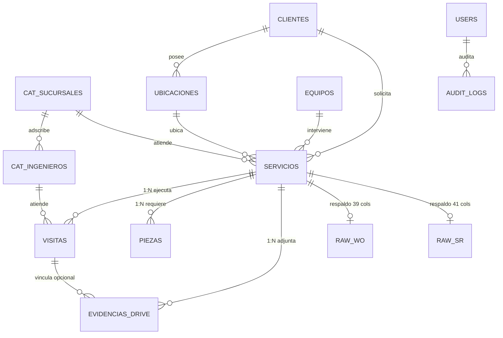
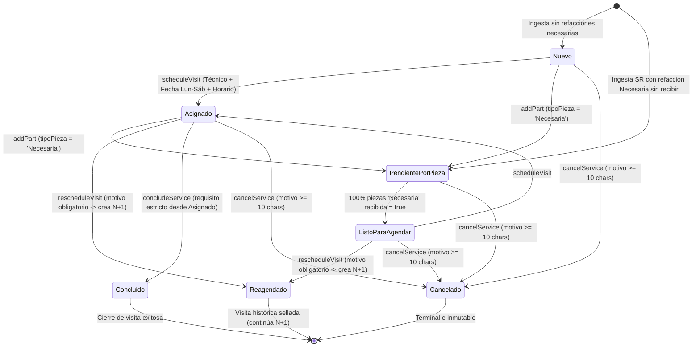
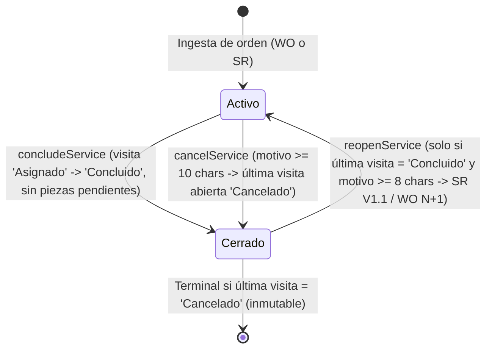

# Modelo de Datos y Máquina de Estados — Lexmark’s Control
**Estándar de Referencia**: IEEE Std 1016-2009 (Data Design & State Transition Models)  
**Módulo**: Esquema Relacional PostgreSQL (Drizzle ORM), Repositorios Agnósticos, Contratos TypeScript y Lógica de Negocio  
**Versión de Esquema**: Relacional PostgreSQL `src/db/schema.ts` (14 tablas) + Contratos `src/types/index.ts`

---

## 1. Arquitectura de Persistencia y Diagrama Entidad-Relación (ERD)

La persistencia principal reside en el servidor mediante **repositorios agnósticos al motor** (`src/server/repositories/interfaces.ts`) instanciados por `repositoryFactory.ts` según `DB_DRIVER`:
- **`postgres`**: Adaptador modular `PostgresServiceRepository` (`src/server/repositories/postgres/Postgres{ServiceRepo,VisitRepository,PartRepository,EvidenceRepository,RawIngestRepository,UnitOfWork}.ts`, `postgresServiceChildren.ts`, `postgresServiceHydration.ts`, `postgresPhysicalEntities.ts`, `postgresCatalogRepository.ts`, `postgresErrors.ts`) conectado a PostgreSQL / Supabase vía `pg.Pool` (`src/db/index.ts`) y esquema Drizzle ORM en `src/db/schema.ts` (`src/db/schema/{catalogTables,entityTables,transactionTables,rawTables,relations}.ts`: **14 tablas** normalizadas + JSONB crudo + transacciones atómicas `db.transaction()`).
- **`memory`**: Adaptador modular `InMemoryServiceRepository` (`src/server/repositories/memory/*`) para desarrollo sin base de datos externa y pruebas automatizadas de contrato.

> **Rol de `localStorage` actualmente**: El navegador únicamente almacena preferencias de interfaz (`lexmark_theme`, `lexmark_sidebar_collapsed`, `lexmark_active_user_profile`) y, opcionalmente, respaldos históricos legados (`lexmark_services_db_v2`, `lexmark_raw_wo_db`, `lexmark_raw_sr_db`) que pueden importarse hacia PostgreSQL con un clic desde `Ajustes y Perfil` (`POST /api/services/migrate-local`).

### 1.1 Esquema PostgreSQL Real (`src/db/schema.ts` / `src/db/schema/*` — 14 Tablas e Índices)

| # | Tabla PostgreSQL | Propósito | Restricciones e Índices Clave |
| :-: | :--- | :--- | :--- |
| **1** | `cat_sucursales` | 9 sedes oficiales (`MID`..`TAP`) | `id_sucursal` PK, `slug` UNIQUE, `codigo_corto` UNIQUE, `nombre_sucursal` UNIQUE |
| **2** | `cat_ingenieros` | Padrón dinámico de ingenieros técnicos | `id_ingeniero` PK, `external_id` UNIQUE, `id_sucursal` FK $\rightarrow$ `cat_sucursales` |
| **3** | `users` | Cuentas autorizadas Google Workspace | `id` PK, `uid` UNIQUE, `email` UNIQUE, `id_sucursal_predeterminada` FK $\rightarrow$ `cat_sucursales` |
| **4** | `clientes` | Razones sociales de clientes | `id_cliente` PK, `nombre_cuenta` UNIQUE |
| **5** | `ubicaciones` | Domicilios físicos por cliente | `id_ubicacion` PK, `id_cliente` FK $\rightarrow$ `clientes` |
| **6** | `equipos` | Parque de impresoras Lexmark | `id_equipo` PK, `numero_serie` UNIQUE, `id_cliente` FK, `id_ubicacion` FK |
| **7** | `servicios` | Contenedor maestro de órdenes WO / SR | `id_servicio` PK; índices `servicios_estatus_tipo_sucursal_idx`, `servicios_sucursal_asignada_idx`, `servicios_fecha_vencimiento_idx`, `servicios_cliente_id_idx`, parcial `servicios_activos_tipo_sucursal_idx` |
| **8** | `visitas` | Iteraciones de visita en campo (`V1`, `1.1`, `V2`) | `id_visita` PK, `id_servicio` FK; índices `visitas_servicio_iteracion_idx`, `visitas_fecha_ingeniero_idx`, `visitas_estatus_idx`, parcial `visitas_asignadas_fecha_idx`, único parcial `visitas_ingeniero_horario_unico_idx` |
| **9** | `piezas` | Refacciones (`Necesaria` / `Restock`) y guías | `id_registro_pieza` PK, `id_servicio` FK; `piezas_servicio_external_uidx`, `piezas_gatekeeper_idx`, parcial `piezas_pendientes_necesarias_idx` |
| **10** | `evidencias_drive` | Archivos vinculados vía Google Drive Picker | `id_evidencia` PK, `id_servicio` FK, `id_visita` FK opcional, `external_id`; índice `evidencias_drive_servicio_idx` |
| **11** | `raw_wo` | Respaldo crudo exacto de las 39 columnas WO + `payload` JSONB | `id_raw_wo` PK, `work_order_number` UNIQUE |
| **12** | `raw_sr` | Respaldo crudo exacto de las 41 columnas SR + `payload` JSONB | `id_raw_sr` PK, `request_number` UNIQUE |
| **13** | `audit_logs` | Bitácora de auditoría por entidad y usuario | `id_audit` SERIAL PK; índices `audit_logs_entidad_idx` y `audit_logs_actor_created_idx` |
| **14** | `access_requests` | Bandeja persistente de solicitudes de acceso Google Workspace | `id` SERIAL PK, `folio` UNIQUE, estatus `'Pendiente'` y consulta RBAC por `created_at DESC` |

### 1.2 Diagrama Mermaid ERD (Relaciones Lógicas y Físicas)



### 1.3 Diagrama Estructurado ASCII

```
┌─────────────────────────────────────────────────────────────────────────────┐
│                    USERS (5 Cuentas Google Autorizadas)                     │
│  coordinacion@ · coordinacion2@ · Fredy.molina@ · gestion@ · administracion@│
└──────────────────────────────────────┬──────────────────────────────────────┘
                                       │ Audita operaciones (audit_logs)
┌──────────────────────┐               ▼               ┌──────────────────────┐
│ CLIENTES/UBICACIONES │──▶ ┌──────────────────────┐ ◀─│ CAT_SUCURSALES (9)   │
└──────────────────────┘    │      SERVICIOS       │   └──────────┬───────────┘
┌──────────────────────┐    │ PK id (8d o 1-XXXX)  │              │ adscribe
│   EQUIPOS (UNIQUE    │──▶ │ type: WO | SR        │              ▼
│    numero_serie)     │    │ estatus: Activo |    │   ┌──────────────────────┐
└──────────────────────┘    │  Cerrado             │   │  CAT_INGENIEROS (18+)│
                            └────┬─────┬─────┬──┬──┘   └──────────┬───────────┘
               ┌─────────────────┘     │     │  └────────┐        │
               ▼                       ▼     ▼           ▼        │
      ┌─────────────────┐   ┌───────────┐  ┌────────┐  ┌──────────────┐
      │     VISITAS     │   │  PIEZAS   │  │ RAW_WO │  │  EVIDENCIAS  │
      │ V1, V2, V1.1    │   │ Gatekeeper│  │ RAW_SR │  │ _DRIVE (URL) │
      │ +reporteTecnico │   │ Necesaria │  │ (JSONB │  └──────────────┘
      │ +correoEnviado  │   │ | Restock │  │ 39/41) │
      └─────────────────┘   └───────────┘  └────────┘
```

---

## 2. Tipado Formal en TypeScript (`src/types/index.ts`)

```typescript
export type ServiceType = 'WO' | 'SR';
export type ServiceGlobalStatus = 'Activo' | 'Cerrado';
export type VisitStatus =
  | 'Nuevo'
  | 'Asignado'
  | 'Pendiente por Pieza'
  | 'Listo para Agendar'
  | 'Reagendado'
  | 'Concluido'
  | 'Cancelado';

export type PartType = 'Necesaria' | 'Restock';

export interface PartRecord {
  id: string;
  codigoPieza: string;
  nombrePieza?: string;
  tipoPieza: PartType;
  guiaEnvio?: string;
  fechaArribo?: string;
  recibida: boolean;
  timestampAlta: string;
}

export interface TechnicalReportRecord {
  horaInicio?: string;
  horaTermino?: string;
  firmware?: string;
  ipEquipo?: string;
  contadorInicial?: string;
  contadorFinal?: string;
  porcentajeKit?: string;
  fallaDetectada?: string;
  causaFalla?: string;
  actividadRealizada?: string;
  pruebasRealizadas?: string[];
  mantenimientoRealizado?: string[];
  estadoEquipo?: string;
  recomendacionesVoltajes?: string;
  observacionesCliente?: string;
}

export interface VisitGmailLog {
  sent: boolean;
  sentAt: string;
  sentBy: string;
  recipient: string;
  messageId?: string;
  error?: string;
}

export interface DriveEvidenceRecord {
  id: string;
  serviceId: string;
  visitId?: string;
  name: string;
  url: string;
  mimeType: string;
  attachedBy: string;
  attachedAt: string;
}

export interface VisitRecord {
  id: string;
  serviceId: string;
  numeroVisita: number | string; // 1, 2, 3 o "1.1" para reaperturas SR
  estatus: VisitStatus;
  ingenieroNombre?: string;
  ingenieroCorto?: string;
  esApoyoForaneo?: boolean;
  fechaVisita?: string; // YYYY-MM-DD (Lun-Sáb)
  horaVisita?: string;  // Bloque 30m 08:00 AM - 08:00 PM
  motivoReagendado?: string;
  timestampCreacion: string;
  reporteTecnico?: TechnicalReportRecord;
  correoEnviado?: VisitGmailLog;
  urlDoc?: string;
  urlPdfPreview?: string;
  urlPdfDownload?: string;
}

export interface ServiceRecord {
  id: string;
  type: ServiceType;
  estatusServicio: ServiceGlobalStatus;
  sucursalAsignada?: string;
  cliente: string;
  modelo: string;
  serie: string;
  mtm?: string;
  productNumber?: string;
  ciudad: string;
  estado: string;
  pais: string;
  direccionCompleta: string;
  contactoNombre: string;
  contactoTelefono: string;
  contactoFijo?: string;
  contactoEmail?: string;
  contactoSecundarioNombre?: string;
  contactoSecundarioTelefono?: string;
  contactoSecundarioEmail?: string;
  resumenFalla: string;
  codigoProblema?: string;
  descripcionProblema?: string;
  fechaCreacion: string;
  slaResolveWithin?: string;
  slaMustResolveBy?: string;
  rawColumns: Record<string, string>;
  visitas: VisitRecord[];
  refacciones: PartRecord[];
  evidencias?: DriveEvidenceRecord[];
  motivoCancelacion?: string;
  motivoReapertura?: string;
  fechaCierre?: string;
  timestampIngesta: string;
  usuarioIngesta: string;
}
```

---

## 3. Siembra Inicial, Contratos de Repositorio y Migración

1. **Contratos de Repositorio (`src/server/repositories/interfaces.ts`)**:
   - Interfaces separadas bajo ISP: `IServiceRepository`, `IVisitRepository`, `IPartRepository`, `IEvidenceRepository`, `IRawIngestRepository`, `ICatalogRepository`, `IUnitOfWork` e `IRepositoryContainer`.
   - Toda consulta o mutación de negocio en `servicesRouter.ts` y `catalogsRouter.ts` consume estas abstracciones sin acoplarse a `pg` ni a `drizzle-orm`.
2. **Siembra Idempotente (`src/db/seed.ts`)**:
   - Puebla de forma segura sin duplicar registros las **9 sucursales oficiales** (`cat_sucursales`), **18 ingenieros base** (`cat_ingenieros`) y **5 perfiles autorizados** (`users`).
3. **Migración Segura desde Respaldos Locales y Normalización de Estatus Legados**:
   - El endpoint `POST /api/services/migrate-local` valida los datos mediante `migrateLocalPayloadSchema` (Zod) e inserta en PostgreSQL/Memoria omitiendo IDs ya existentes.
   - `migrateLegacyStatuses(executor)` en `src/db/migrateStatuses.ts` ejecuta una migración SQL idempotente en transacción para consolidar estatus legados: `servicios.estatus_global` (`'Concluido' | 'Cancelado'` $\rightarrow$ `'Cerrado'`), `visitas.estatus_visita` (`'Activo'` $\rightarrow$ `'Asignado'`) y última visita abierta de servicios cancelados ($\rightarrow$ `'Cancelado'`), complementada en lectura por `normalizeServiceGlobalStatus()` y `normalizeVisitStatus()`.

---

## 4. Máquina de Estados Finitos (`src/domain/serviceStateMachine.ts`)

Todas las transiciones se ejecutan de forma pura e inmutable en `src/domain/serviceStateMachine.ts` (compuesta por `src/domain/stateMachine/{statusHelpers,branchAndPartsRules,visitSchedulingRules,lifecycleAndReportRules}.ts` y reexportada mediante `StateMachineService`). Consultas, ordenamiento y paginación determinista residen en `src/domain/serviceQuery.ts`.

### 4.1 Diagrama Mermaid de Estados de la Visita Técnica



### 4.2 Diagrama Mermaid de Estados Globales del Servicio



### 4.3 Reglas Críticas Implementadas en Código
- **Cierre Global Unificado (`estatusServicio = 'Cerrado'`)**: Tanto concluir como cancelar llevan `estatusServicio` a `'Cerrado'`. La distinción operativa reside en la última visita y motivo: `isServiceConcluded` verifica última visita `'Concluido'`, mientras que `isServiceCancelled` verifica última visita `'Cancelado'` (o `motivoCancelacion` legado).
- **Precondición Estricta de Conclusión (`concludeService`)**: Únicamente permite concluir cuando la visita actual se encuentra exactamente en estatus **`'Asignado'`** y no hay piezas `'Necesaria'` pendientes (`GATEKEEPER_BLOCKED`); rechaza con `INVALID_TRANSITION` si la visita sigue en `'Nuevo'`, `'Listo para Agendar'` o `'Pendiente por Pieza'`.
- **Bloqueo Solo Lectura (`canEditService`) y Cancelación Terminal**: Todo servicio `'Cerrado'` rechaza mutaciones con HTTP `409 READ_ONLY_SERVICE`. Si cerró por cancelación (`isServiceCancelled`), es **terminal e inmutable** (`reopenService` también devuelve `READ_ONLY_SERVICE`); si cerró por conclusión, admite `reopenService` con justificación $\ge 8$ caracteres.
- **Numeración de Visitas (`createNextVisitRecord`)**:
  - Reagendamiento (`WO` o `SR`): siempre entero consecutivo (`V1` $\rightarrow$ `V2` $\rightarrow$ `V3`).
  - Reapertura tras conclusión: en **SR** genera versión decimal (`V1` $\rightarrow$ `V1.1` $\rightarrow$ `V1.2`); en **WO** genera entero consecutivo (`V1` $\rightarrow$ `V2`).
- **Horario Laboral y Traslapes (`src/domain/scheduleRules.ts` y `visitAgenda.ts`)**:
  - Bloques válidos cada 30 minutos de `08:00 AM` a `08:00 PM`, exclusivamente lunes a sábado y fechas no pasadas (`YYYY-MM-DD`).
  - El servidor rechaza con HTTP `409 SCHEDULE_COLLISION` cuando el mismo ingeniero ya tiene otra visita activa en el mismo día y bloque horario.

---

## 5. Algoritmo de Compuerta (*Gatekeeper Pattern*)

$$\text{isBlocked} = \exists \, p \in \text{service.refacciones} \mid (p.\text{tipoPieza} = \text{'Necesaria'} \land \neg p.\text{recibida})$$

1. **Alta de refacción `Necesaria` (`addPart`)**: Si `recibida === false`, conmuta la última visita abierta a `'Pendiente por Pieza'` y bloquea `scheduleVisit` y `concludeService` (`GATEKEEPER_BLOCKED`).
2. **Confirmación de arribo (`togglePartReceived` / `confirmPartReceived`)**: Soporta confirmar una pieza específica, un subconjunto de IDs o `'ALL'`. Cuando el 100% de las piezas `'Necesaria'` tienen `recibida === true`:
   - Si la visita actual estaba en `'Pendiente por Pieza'`, avanza automáticamente a `'Listo para Agendar'`.
   - Si la visita ya estaba programada en `'Asignado'`, conserva su cita sin sobrescribirla.
3. **Refacciones `Restock`**: Informativas; nunca bloquean la programación ni alteran el estado de la visita.
