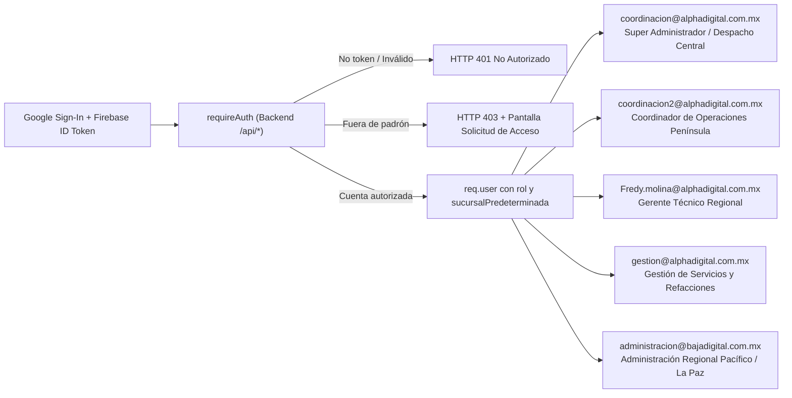

# Glosario y Catálogos Oficiales del Negocio — Lexmark’s Control

Este documento describe los conceptos operativos, catálogos oficiales, reglas de SLA, estados del flujo de trabajo y cuentas corporativas autorizadas que operan en **Lexmark’s Control** para **Alpha Digital** y **Baja Digital**.

---

## 1. Work Orders (WO) vs. Requerimientos Proactivos (SR)

```text
┌─────────────────────────────────┐       ┌─────────────────────────────────┐
│        WORK ORDER (WO)          │       │    PROACTIVO / PREVENTIVA (SR)  │
├─────────────────────────────────┤       ├─────────────────────────────────┤
│ • Servicio Correctivo (Falla)   │       │ • Servicio Preventivo / Kit     │
│ • Estructura de 39 Columnas     │       │ • Estructura de 41 Columnas     │
│ • Color de Acento: VERDE CLARO  │       │ • Color de Acento: AMARILLO ORO │
│   (#308C50)                     │       │   (#D9B13B)                     │
│ • ID numérico (ej. 12288745)    │       │ • ID Request (ej. 1-847291029411│
│ • Reapertura: Visita N+1 (V2)   │       │ • Reapertura: Decimal (V1.1)    │
└─────────────────────────────────┘       └─────────────────────────────────┘
```

- **Work Orders (WO)**: Servicios reactivos para reparar equipos detenidos o con fallas reportadas (`Work Order Number` de 39 columnas). Su color identificador en toda la app y documentos es **verde `#308C50`**.
- **Service Requests (SR / Proactivas)**: Servicios preventivos o proactivos (`Request Number` de 41 columnas) con ventana de cumplimiento **SLA** (*Must Resolve By*). Su color identificador es **amarillo oro `#D9B13B`** (utilizando `#8a6808` en textos e iconos sobre fondo claro para garantizar contraste WCAG 2.1 AA $\ge 4.5:1$).

---

## 2. Catálogo Oficial de las 9 Sucursales (`cat_sucursales`)

Las sedes inactivas permanecen en el catálogo histórico pero están bloqueadas para nuevas asignaciones de despacho:

| Código | Sede Oficial | Estado | Estatus Operativo | Cobertura Principal |
| :---: | :--- | :--- | :--- | :--- |
| **MID** | **Alpha Digital Sucursal Mérida** | Yucatán | **Activa** | Mérida, Progreso, Umán, Kanasín, Valladolid |
| **CUN** | **Alpha Digital Sucursal Cancún** | Quintana Roo | **Activa** | Benito Juárez, Playa del Carmen, Cozumel, Tulum |
| **CTM** | **Alpha Digital Sucursal Chetumal** | Quintana Roo | **Activa** | Othón P. Blanco, Bacalar, Carrillo Puerto |
| **CPE** | **Alpha Digital Sucursal Campeche** | Campeche | **Activa** | Campeche, Champotón |
| **CME** | **Alpha Digital Sucursal Ciudad del Carmen** | Campeche | **Activa** | Carmen, Escárcega |
| **LAP** | **Baja Digital Sucursal La Paz** | Baja California Sur | **Activa** | La Paz, Comondú, Loreto |
| **SJD** | **Baja Digital Sucursal Los Cabos** | Baja California Sur | **Activa** | San José del Cabo, Cabo San Lucas |
| **TGZ** | **Alpha Digital Sucursal Tuxtla Gutiérrez** | Chiapas | **Inactiva** | Bloqueada para asignación operativa |
| **TAP** | **Alpha Digital Tapachula** | Chiapas | **Inactiva** | Bloqueada para asignación operativa |

---

## 3. Catálogo Base de Ingenieros Técnicos (`cat_ingenieros`)

El sistema se inicializa con **18 ingenieros base** persistidos en base de datos y **administrables dinámicamente** desde `Ajustes y Perfil -> Ingenieros` (donde se pueden crear nuevos ingenieros, editar su nombre/mote/sucursal o activar/desactivar disponibilidad):

- **Mérida (`MID`)**: Gaspar Luciano Pool Estrella (`GASPAR`), Israel A. Martinez Tenorio (`ISRAEL`), Oscar Erick Gonzalez Chaparro (`OSCAR`).
- **Cancún (`CUN`)**: Jesus Alberto Lara Arceo (`ALBERTO`), Jhoan Andrés Vazquez Chim (`JHOAN`), Gonzalo Casildo Trejo (`GONZALO`), Juan Carlos Ventura Salazar (`VENTURA`), Juan Lazaro Mayo Chan (`LAZARO`).
- **Chetumal (`CTM`)**: Gildardo Filiberto Hernández Ramirez (`GILDARDO`).
- **Campeche (`CPE`)**: Francisco Caamal Urdapilleta (`FRANCISCO`).
- **Ciudad del Carmen (`CME`)**: Juan Marcos Zavala Carballo (`ZAVALA`).
- **La Paz (`LAP`)**: Jose Vicente Flores Ojeda (`VICENTE`), Diego Alberto Mazariegos (`DIEGO`).
- **Los Cabos (`SJD`)**: Angel Omar Amador Meza (`ANGEL`).
- **Chiapas (`TGZ` / `TAP`, inactivos en semilla base)**: Julio Cesár Sarmiento Pérez (`JULIO`), Lorenzo Leandro Santiz Grajales (`LORENZO`), Luis Alberto Cobá Pech (`COBA`), Luis Enrique Cruz Sanchez (`CRUZ`).

---

## 4. Indicadores de SLA (*Must Resolve By*)

La evaluación SLA (`src/domain/slaEvaluator.ts`) calcula el margen restante hacia `slaMustResolveBy` y alimenta tanto los indicadores de fila (estáticos, sin animaciones parpadeantes) como el porcentaje de cumplimiento en la barra superior (`Header.tsx`):

- **En Tiempo (`verde`)**: Margen suficiente respecto a la fecha límite comprometida.
- **Urgente / Próximo a Vencer (`ámbar`)**: Quedan pocas horas o menos de un día para cumplir el compromiso *Must Resolve By*; requiere despacho prioritario.
- **Vencido / Crítico (`rojo`)**: La fecha comprometida ha sido rebasada en una orden aún abierta.

---

## 5. Estatus del Servicio Global y Estatus de Visita

### Estatus del Servicio Global (`servicios.estatus_global`)
- **Activo**: Orden abierta en curso.
- **Cerrado**: Orden finalizada o anulada en modo solo lectura (pasa a Historial / Cerradas). La última visita determina si cerró como **Concluido** (reabrible mediante *Reactivar Servicio*) o **Cancelado** (terminal e inmutable, sin reapertura).

### Estatus de Visita Técnica (`visitas.estatus_visita`)
1. **Nuevo**: Ingresado sin visita ni refacción bloqueante activa.
2. **Asignado**: Programado con ingeniero, fecha (Lun–Sáb) y horario (bloques 30 min, `08:00 AM`–`08:00 PM`). Única etapa desde la que se permite **Concluir Servicio**.
3. **Pendiente por Pieza**: Bloqueado por el *Gatekeeper* porque existe al menos una refacción de tipo `Necesaria` aún no recibida.
4. **Listo para Agendar**: Desbloqueado tras recibir el 100% de las refacciones `Necesaria`, tras reagendamiento (`Reagendado` -> nueva visita) o tras reapertura (`Reactivar Servicio`).
5. **Reagendado**: Visita cerrada por imposibilidad de atención en sitio, dando paso a la visita consecutiva.
6. **Concluido**: Visita finalizada con cierre exitoso (el servicio pasa a `Cerrado`).
7. **Cancelado**: Visita anulada con motivo obligatorio ($\ge 10$ caracteres); el servicio pasa a `Cerrado` de forma terminal e irreversible.

---

## 6. Padrón Oficial de Cuentas Google Autorizadas y Autenticación RBAC

El acceso al sistema (cliente Firebase OAuth + middleware backend `src/server/middleware/requireAuth.ts`) valida que el Firebase ID Token sea legítimo, tenga correo verificado y pertenezca exactamente a una de las **5 cuentas corporativas registradas** en `src/data/catalogs.ts`:



```text
┌──────────────────────────────────────────────────────────────────────────────┐
│                 PADRÓN CORPORATIVO AUTORIZADO (GOOGLE_USERS)                 │
├──────────────────────────────────────┬───────────────────────────┬───────────┤
│ Correo Autorizado                    │ Rol en Sistema            │ Sede Base │
├──────────────────────────────────────┼───────────────────────────┼───────────┤
│ coordinacion@alphadigital.com.mx     │ Super Administrador /     │ Mérida    │
│                                      │ Despacho Central          │           │
│ coordinacion2@alphadigital.com.mx    │ Coordinador de            │ Cancún    │
│                                      │ Operaciones Península     │           │
│ Fredy.molina@alphadigital.com.mx     │ Gerente Técnico Regional  │ Mérida    │
│ gestion@alphadigital.com.mx          │ Gestión de Servicios      │ Cancún    │
│                                      │ y Refacciones             │           │
│ administracion@bajadigital.com.mx    │ Administración Regional   │ La Paz    │
│                                      │ Pacífico / La Paz         │           │
└──────────────────────────────────────┴───────────────────────────┴───────────┘
```

> **Control de acceso técnico**: Todas las rutas privadas `/api/*` validan identidad y pertenencia al padrón mediante `requireAuth`, adjuntando `req.user` (`uid`, `id`, `email`, `nombre`, `rol`, `sucursalPredeterminada`), y el middleware dispone de `requireRole(...)` para restricciones granulares por perfil en rutas administrativas. Las únicas rutas públicas son `/api/health` y `/api/access-requests`.
